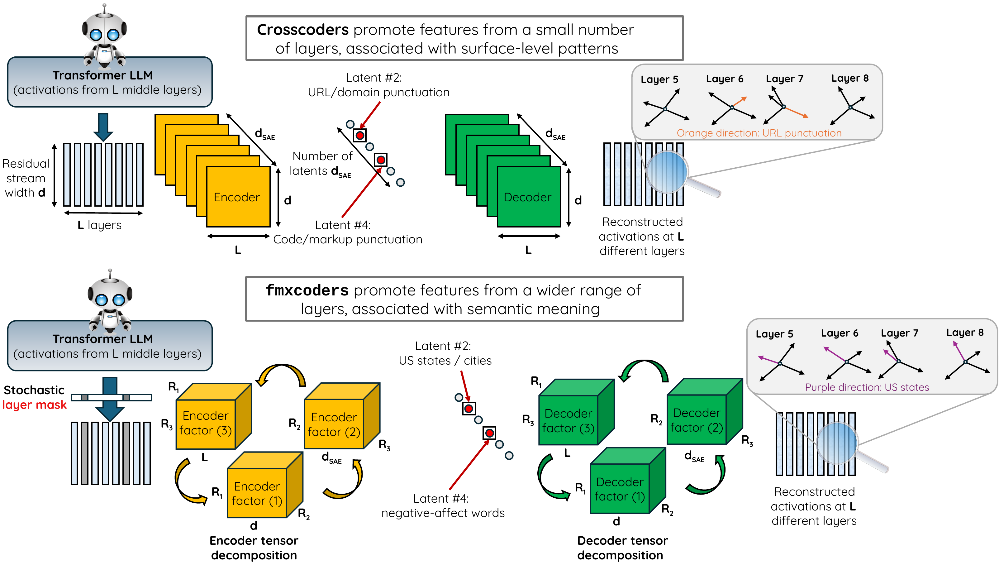
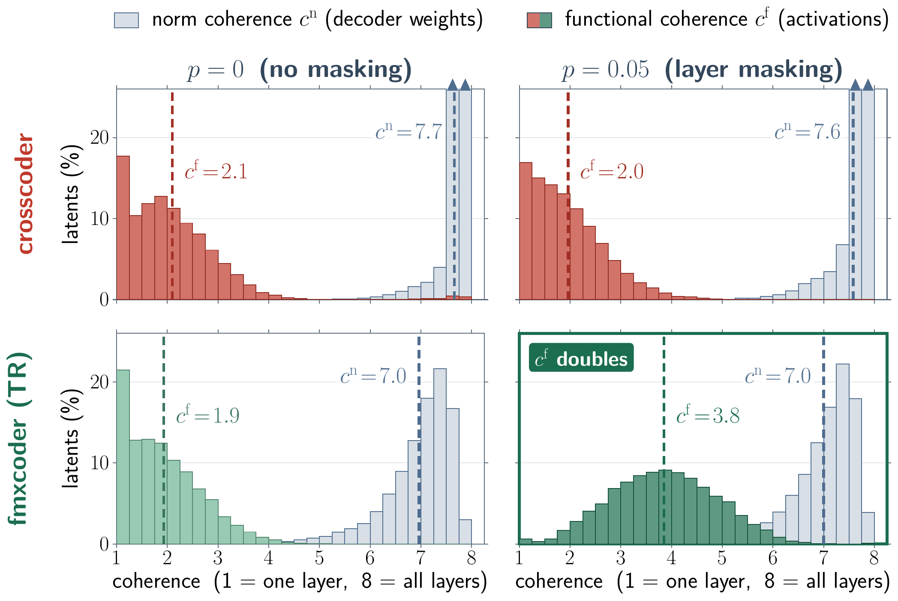

# `fmxcoders`: Factorized Masked Crosscoders for Cross-Layer Feature Discovery

[](https://arxiv.org/abs/2605.09438)
[](https://neurips.cc/virtual/2026/loc/sydney/poster/154897)
[](#-installation)
[](LICENSE)

🌟 **NeurIPS 2026 Spotlight**

> ### ❓ Can we find interpretable cross-layer features in pretrained LLMs?
>
> 🟥 **Current crosscoders** use input from all layers, yet their latents are **layer-local in function** and encode **surface patterns**.
>
> 🟩 **Our `fmxcoders`**: **low-rank tensor factorization** and **stochastic layer masking** make latents **span layers** and encode **concepts**.

<p align="center"></p>

## ✨ Highlights

| 🎯 Sparse probing | 🔧 Reconstruction | 🧠 Semantic latents | 🔗 Functional coherence |
|:---:|:---:|:---:|:---:|
| **+10–30** F1 points | **−25–50%** MSE | **2.6–14×** more (LLM judges) | **≈2×** (2.1 → 3.8) |

All relative to the standard crosscoder, on GPT-2 Small, Pythia-410M, Pythia-1.4B and Gemma-2-2B, at equal parameter count and <10% extra training time. On sparse probing, `fmxcoders` also beat **per-layer SAEs**, a baseline that standard crosscoders fail to reach.

---

## 1️⃣ Crosscoder latents are layer-local

**Do crosscoder latents span layers in practice?**

- **Cross-layer features in LLMs** are built through stages of inference and persist in the residual stream.
- **Crosscoders aim to capture cross-layer features** with one sparse dictionary over all $L$ layers.
- **Yet each latent is driven by only 1 to 2 layers** on average, although its decoder norms spread evenly across all of them.

### Measuring cross-layer dependence

Given how much latent $i$ depends on each layer, $s_i^{\ell} \ge 0$, its **coherence** is

$$c_i = \frac{\sum_{\ell=1}^{L} s_i^{\ell}}{\max_{\ell} s_i^{\ell}} \in [1, L] \qquad (1: \text{one layer},\ L: \text{all layers equally}).$$

| | Metric | Per-layer dependence $s_i^{\ell}$ |
|:---|:---|:---|
| Current metric | **Norm coherence** $c^{\mathrm{n}}$ | decoder norm of latent $i$ at layer $\ell$: $\ \lVert \mathbf{D}_{:,i,\ell} \rVert_2$ |
| ⭐ **Our metric** | **Functional coherence** $c^{\mathrm{f}}$ | change of $z_i$ when $M_\ell$ zeroes layer $\ell$: $\ \mathbb{E}_{\mathbf{x}}\left\lvert \frac{z_i(\mathbf{x}) - z_i(M_\ell(\mathbf{x}))}{z_i(\mathbf{x}) + \epsilon} \right\rvert$ |



On Pythia-410M (16,384 latents), $c^{\mathrm{n}}$ stays near 7 of 8 throughout, while $c^{\mathrm{f}}$ sits near 2: **the weights span the layers, the function does not**. Only factorization and masking together double $c^{\mathrm{f}}$.

### Coherence separates concepts from patterns

| Top-activating tokens | Concept | $c^{\mathrm{f}}$ | $c^{\mathrm{n}}$ |
|:---|:---|:---:|:---:|
| lobbying, campaigned, pleaded | advocacy | 🟩 **7.1** | 6.1 |
| regret, despise, failure | negative affect | 🟩 **7.0** | 6.9 |
| Philadelphia, Maryland, Florida | US places | 🟩 **6.9** | 6.7 |
| 1, 2, 3, 4 | digits | 🟥 **1.0** | 5.8 |
| def, set, define, -> | code syntax | 🟥 **1.0** | 6.2 |
| ), ;, }, ) | closing braces | 🟥 **1.0** | 5.5 |

Gemma-2-2B, `fmxcoder` ($p = 0.05$) latents. $c^{\mathrm{n}}$ stays within 5.5–6.9 while $c^{\mathrm{f}}$ spans 1.0–7.1, so **only function separates concepts from patterns**.

## 2️⃣ Factorization and masking yield cross-layer latents

Standard crosscoders (top of the figure above) use $L$ independent per-layer matrices; `fmxcoders` (bottom) replace them with a shared low-rank factorization and add stochastic layer masking.

- **L1. Unconstrained structure → factorization.** Given the activations $\mathbf{x}_\ell$ of each layer $\ell$, a crosscoder assigns an encoder $\mathbf{E}_\ell$ and a decoder $\mathbf{D}_\ell$ to every layer to learn one latent vector $\mathbf{z}$:
  $$\mathbf{z} = \mathcal{S}\Big(\mathrm{ReLU}\big(\textstyle\sum_{\ell} \mathbf{E}_\ell^{\top} \mathbf{x}_\ell + \mathbf{b}^{\mathrm{enc}}\big)\Big), \qquad \hat{\mathbf{x}}_\ell = \mathbf{D}_\ell \mathbf{z} + \mathbf{b}^{\mathrm{dec}}_\ell .$$
  These per-layer matrices are unconstrained and the loss decomposes over layers. `fmxcoders` factorize the stacked encoder $\mathbf{E} \in \mathbb{R}^{d \times d_{\mathrm{sae}} \times L}$ (and decoder) as a **tensor ring** (or CP), so all latents draw their per-layer weights from shared factors.
- **L2. Unregularized dependence → layer masking.** Even with shared factors, a latent can rely on one layer at no cost. During training each layer's input is zeroed at random, $\tilde{\mathbf{x}}_\ell = m_\ell \mathbf{x}_\ell$ with $m_\ell \sim \mathrm{Bernoulli}(1-p)$, while every clean $\mathbf{x}_\ell$ is reconstructed: a denoising objective along the layer axis. Single-layer latents pay a cost growing with $p$; distributed ones do not.

### What each component adds (Pythia-410M)

| | Factorize | Mask | MSE ↓ | F1 ↑ | $c^{\mathrm{f}}$ ↑ | |
|:---|:---:|:---:|:---:|:---:|:---:|:---|
| Standard crosscoder | | | 🟥 0.05 | 🟥 47.4 | 🟥 2.1 | layer-local, weak probing |
| Factorized only | ✓ | | 🟩 0.03 | 🟩 74.3 | 🟥 1.9 | **better probing** and reconstruction, still layer-local |
| **`fmxcoder`** | ✓ | ✓ | 🟩 0.03 | 🟩 68.1 | 🟩 **3.8** | **cross-layer features**: coherence doubles, probing stays high |

Masking alone (no factorization) leaves $c^{\mathrm{f}}$ at 2.0: masking can only reweight layers a latent already uses, and the shared factors let it reach new ones. The masking probability $p$ is a knob: $p = 0$ gives the best probing, $p = 0.05$ trades a few F1 points for cross-layer latents.

### Steering with single latents

| Feature | Prompt | Regular output | Steered output | $\Delta p$ |
|:---|:---|:---|:---|:---:|
| Stages / steps of a process | "Nobody warned me about the" | pain of childbirth… | → **steps I would have to take** to get my life back… | +56 |
| "Once X, now Y" pivot | "The factory where my father worked" | was a small one… | → **now is a museum**… | +53 |
| The name "Taylor" | "The street is named after a nineteenth-century mill owner named" | John Smith… | → John **Taylor**… | +34 |
| Vast number of options | "By the end of the week he had received" | a letter from the head of the department… | → **thousands of messages** of support… | +25 |
| Concealment | "The new packaging was designed to" | be more environmentally friendly… | → **hide the fact** that the product is made from plastic… | |
| Accidentally | "During the demo on Thursday afternoon, she" | said, "I'm going to be a little bit more aggressive… | → **inadvertently revealed** that the game will be released… | |
| Country / state name | "Dr. Amara Nwosu, who runs the computational biology unit at the children's hospital," | is one of the researchers who has been working on the project… | → is a professor of pediatrics and biomedical informatics at the **University of Michigan**… | |
| Elapsed time | "They opened the restaurant and closed it" | down in 2019… | → **2 weeks later**… | |

Gemma-2-2B, one `fmxcoder` ($p = 0.05$) latent at a time. $\Delta p$: increase (percentage points) in the probability that the target token (e.g. "steps") is predicted next, averaged over generic prompts ("tone": +44).

## 3️⃣ Better than crosscoders and SAEs

### More discriminative latents (sparse probing)

Mean F1 over six probing tasks, $K = 1$:

| Model | Per-layer SAE | Crosscoder | `fmxcoder` ($p = 0$) | `fmxcoder` ($p = 0.05$) | Gain vs. crosscoder |
|:---|:---:|:---:|:---:|:---:|:---:|
| GPT-2 Small | 65.7 | 67.6 | **78.3** | 73.5 | +10.7 |
| Pythia-410M | 65.0 | 47.4 | **74.3** | 68.1 | +26.9 |
| Pythia-1.4B | 64.6 | 47.0 | **78.4** | 71.2 | +31.4 |
| Gemma-2-2B | 64.8 | 51.2 | **81.9** | 73.0 | +30.7 |

The crosscoder trails per-layer SAEs by 13–18 F1 on three LLMs, whereas `fmxcoders` **exceed them on every LLM** (22 of 24 LLM–task pairs) and raise class separation ($W_1$) over the crosscoder by one to three orders of magnitude.

### Better signal modeling (reconstruction)

| MSE ↓ | Per-layer SAE | Crosscoder | `fmxcoder` ($p = 0$) | `fmxcoder` ($p = 0.05$) | Δ vs. crosscoder |
|:---|:---:|:---:|:---:|:---:|:---:|
| GPT-2 Small | 0.53 | 0.64 | **0.32** | 0.33 | −50% |
| Pythia-410M | **0.03** | 0.05 | **0.03** | **0.03** | −40% |
| Pythia-1.4B | **0.22** | 0.31 | **0.22** | 0.23 | −29% |
| Gemma-2-2B | **1.58** | 3.29 | 2.03 | 2.07 | −38% |

Masking costs little reconstruction.

### More semantic latents (LLM-as-a-judge)

Ratio of `fmxcoder` ($p = 0.05$) to crosscoder latents labeled semantic or surface by three LLM judges:

| | GPT-2 Small | Pythia-410M | Pythia-1.4B | Gemma-2-2B |
|:---|:---:|:---:|:---:|:---:|
| **Semantic** | **14.0×** | **9.4×** | **2.6×** | **7.0×** |
| Surface | 2.2× | 3.0× | 1.2× | 0.8× |

See the [paper](https://arxiv.org/abs/2605.09438) for explained variance, cosine similarity, CP results, rank/masking sweeps and ablations.

---

## 📦 Installation

Requires Python ≥ 3.10 and a CUDA GPU for anything beyond toy runs. Tested with `torch 2.9.1`, `transformers 4.57.3`, `transformer-lens 2.16.1` and `datasets 3.6.0`.

```bash
git clone https://github.com/AndreasDemou/fmxcoders.git
cd fmxcoders
python -m venv .venv && source .venv/bin/activate

pip install torch                 # pick the build for your CUDA version (https://pytorch.org)
pip install -e .                  # this repo's SAELens fork
pip install -e ./SAEBench         # this repo's SAEBench fork
```

> [!IMPORTANT]
> Use the `sae_lens` and `SAEBench` **bundled in this repo**. The upstream packages do not contain the crosscoder code. `train_and_saebench.py` puts `./SAEBench` first on the import path automatically (override with `--saebench_repo_dir`).

For the exact paper environment: `pip install -r requirements.freeze.txt`, then `pip install -e . --no-deps && pip install -e ./SAEBench --no-deps`. Gemma-2 and Llama weights are gated, so run `huggingface-cli login`. Log in to W&B (`wandb login`) or pass `--no_wandb`.

Sanity check:

```bash
python validate_crosscoder.py     # short pythia-70m run: shapes, masking, CP/TR, save/load
pytest tests/saes/test_crosscoder_single_layer_view.py
```

## 🏋️ Training an `fmxcoder`

Pythia-410M, layers 8–15, Tensor Ring factorization + layer masking, as in the paper:

```bash
python train_and_saebench.py \
  --exp pythia410m_l15 --architecture batchtopk \
  --width 16k --k 64 --training_tokens 500000000 --context_size 128 \
  --no_rescale_by_decoder_norm --use_saelens_defaults \
  --use_crosscoder --cross_layers 8,9,10,11,12,13,14,15 \
  --use_cross_fact --cross_fact_type TR --cross_fact_ranks 27,7,302 \
  --layer_masking 0.05 \
  --checkpoint_path checkpoints/pythia410m_m0_05_r27-7-302 \
  --wandb_run_name pythia410m_m0_05_r27-7-302 \
  --seed 42 --run_saebench
```

The two components map to two flags, so every variant in the paper is a flag away:

| Model | Flags |
|---|---|
| Standard crosscoder | `--use_crosscoder --cross_layers …` |
| Masked crosscoder | `… --layer_masking 0.05` |
| Factorized crosscoder | `… --use_cross_fact --cross_fact_type {CP,TR} --cross_fact_ranks …` |
| **`fmxcoder`** | factorization **and** masking |
| CP `fmxcoder` (Pythia-410M) | `--cross_fact_type CP --cross_fact_ranks 7707 --layer_masking 0.05` |

Checkpoints are written to `<checkpoint_path>/final_<n_tokens>/` (`cfg.json` + `sae_weights.safetensors`). Run names follow `<model>_m<mask>_r<ranks>`: `pythia410m_m0_05_r27-7-302` is $p = 0.05$ with TR ranks (27, 7, 302), and `pythia410m_m0` is the standard crosscoder. `launch.sh` is a resumable launcher (set `CKPT_ROOT`; default `./checkpoints`).

<details>
<summary><b>⚙️ Key arguments</b></summary>

| Argument | Description |
|---|---|
| `--exp` | Preset: `gpt2_l8`, `pythia70m_l3`, `pythia70m_l5`, `pythia160m_l8`, `pythia410m_l15`, `pythia1_4b_l12`, `gemma2_2b_l12`, `gemma2_2b_l19`, `gemma2_27b_l22`, `llama31_8b_l25`, `llama32_3b_l12` |
| `--architecture` | Sparsity mechanism: `topk`, `batchtopk`, `jumprelu`, `matryoshka` (crosscoder variants exist for `topk`, `batchtopk`, `matryoshka`) |
| `--width`, `--k` | Dictionary size (`2k` … `131k`) and number of active latents |
| `--use_crosscoder`, `--cross_layers` | Enable the crosscoder and choose layers (comma-separated) |
| `--layer_masking` | Per-token, per-layer input-masking probability (`0` disables) |
| `--use_cross_fact`, `--cross_fact_type`, `--cross_fact_ranks` | Tensor factorization: `CP` takes 1 rank, `TR` takes 3 |
| `--act_store_device cpu` | Keep the activation buffer in host RAM for large crosscoders (avoids GPU OOM) |
| `--resume_from_checkpoint` | Resume from the latest snapshot in `--checkpoint_path` |
| `--run_saebench`, `--eval_only`, `--skip_eval` | Run SAEBench after training, or only evaluate an existing checkpoint |

</details>

<details>
<summary><b>📐 Factorizations</b></summary>

With `L` = number of layers, `d` = `d_in`, `s` = `d_sae`, the encoder `W_enc ∈ ℝ^{L×d×s}` and decoder `W_dec ∈ ℝ^{s×L×d}` are factorized independently and never materialized in the forward pass:

- **CP** (`--cross_fact_type CP --cross_fact_ranks R`): `W_enc[l,d,s] = Σ_r A[l,r] · B[d,r] · C[s,r]`.
- **Tensor Ring** (`--cross_fact_type TR --cross_fact_ranks r1,r2,r3`): cores `G_n ∈ ℝ^{r1×L×r2}`, `G_d ∈ ℝ^{r2×d×r3}`, `G_s ∈ ℝ^{r3×s×r1}`; the layer mode is bordered by `(r1, r2)`, `d_in` by `(r2, r3)`, and `d_sae` by `(r3, r1)`.

Initialization is variance-matched to Kaiming-uniform on a per-layer slice. Layer masking zeroes each layer's *input* independently per token with probability `p`, while the reconstruction target stays unmasked. Implementation: [`sae_lens/saes/crosscoder_sae.py`](sae_lens/saes/crosscoder_sae.py).

</details>

### Loading a trained `fmxcoder`

```python
from _crosscoder_eval_utils import load_crosscoder_inference   # run from the repo root

sae = load_crosscoder_inference("checkpoints/pythia410m_m0_05_r27-7-302/final_500002816", device="cuda")
hook_names = sae.cfg.metadata.hook_names        # one hook per crosscoder layer

# x: stacked residual activations [batch, seq, n_layers, d_in]
z = sae.encode(x)                                # [batch, seq, d_sae]
x_hat = sae.decode(z)                            # [batch, seq, n_layers, d_in]

layer_view = sae.as_single_layer_view(layer_idx=3)   # 2-D slice for single-layer SAE evals
```

`SAE.load_from_disk` raises a `KeyError` on training-only architectures such as `cross_batchtopk`. `load_crosscoder_inference` loads the checkpoint as a `TrainingSAE`, exports its inference counterpart (folding decoder norms, converting the TopK threshold) and reloads it as an `SAE`.

## 📊 Evaluation

Every script takes a `final_*` checkpoint and writes to `eval_results/`, `coherence_results/` or `steering_results/`. The `run_*.sh` files are the SLURM scripts used for the paper (`cp env.example.sh env.sh`, edit the checkpoint list, then `sbatch` or `bash` from the repo root).

| Paper result | Script |
|:---|:---|
| Sparse probing, reconstruction (SAEBench) | `train_and_saebench.py --eval_only --run_saebench` |
| Per-layer MSE / EV / cosine similarity | `eval_crosscoder_reconstruction.py` |
| Norm coherence $c^{\mathrm{n}}$ | `eval_norm_coherence.py` |
| Functional coherence $c^{\mathrm{f}}$ | `eval_mask_coherence.py --masking_strategy zero` |
| Top/bottom-coherence latents | `extract_token_features*.py`, `top_bottom_coherence.py` |
| Steering | `eval_feature_steering.py`, `gen_feature_steering.py` |
| Absorption / RAVEL (per-layer slice) | `compare_absorption.py`, `compare_ravel.py` |

<details>
<summary><b>Commands</b></summary>

```bash
# 1. SAEBench: sparse probing + reconstruction
python train_and_saebench.py --exp pythia410m_l15 --architecture batchtopk --width 16k --k 64 \
  --use_crosscoder --cross_layers 8,9,10,11,12,13,14,15 \
  --use_cross_fact --cross_fact_type TR --cross_fact_ranks 27,7,302 \
  --checkpoint_path checkpoints/pythia410m_m0_05_r27-7-302 \
  --eval_only --run_saebench --skip_eval tpp --skip_eval scr --skip_eval ravel --skip_eval absorption

# 2. Cross-layer reconstruction (SAEBench core methodology, per layer)
python eval_crosscoder_reconstruction.py --checkpoint_path <ckpt>/final_XXXX \
  --n_batches 2000 --batch_size_prompts 16 --context_size 128 --out eval_results/<run>/recon_metrics.json

# 3. Coherence: norm (weights only) and functional (layer ablation)
python eval_norm_coherence.py --checkpoint_path <ckpt> --output_dir coherence_results/<run>/norm_decoder
python eval_mask_coherence.py --checkpoint_path <ckpt> --output_dir coherence_results/<run>/mask_zero \
  --masking_strategy zero --n_batches 1000 --batch_size_prompts 16 --context_size 128

# 4. Latents and steering
python extract_token_features.py --checkpoint <ckpt> --n_texts 100000
python extract_token_features_pivot.py eval_results/<run>/feature_analysis/token_features.json
python count_latent_tokens.py eval_results/<run>/feature_analysis/token_features_pivot.json
python top_bottom_coherence.py --run_name <run>
python eval_feature_steering.py --checkpoint_path <ckpt> --contexts_from top_bottom_coherence_<run>.json \
  --groups top_most_coherent --all_layers --delta_mode increment --coeffs 1,2,4,6,8
python gen_feature_steering.py --checkpoint_path <ckpt> --contexts_from top_bottom_coherence_<run>.json \
  --prompts_from steering_prompts.json --all_layers --delta_mode increment --coeffs 0.5,1,2,4,8

# 5. Absorption / RAVEL on one layer of the crosscoder
python compare_absorption.py --checkpoint <ckpt>/final_XXXX --layer-idx 4 --model-name pythia-410m-deduped
python compare_ravel.py      --checkpoint <ckpt>/final_XXXX --layer-idx 4 --model-name gemma-2-2b

# Summaries
python fetch_local_run_metrics.py <run_name>       # probing F1 + per-layer reconstruction, LaTeX row
python summarize_evals.py                          # RAVEL / absorption table across runs
```

Notes:
- The coherence scripts report `mean_ℓ / max_ℓ = c_i / L ∈ [1/L, 1]`; multiply by `L` to get the paper's $c^{\mathrm{n}}, c^{\mathrm{f}} \in [1, L]$.
- SAEBench's core eval has a crosscoder branch with per-layer and layer-averaged metrics; KL and CE-loss metrics are skipped for crosscoders.
- RAVEL supports only the models in SAEBench's `LLM_NAME_MAP` (currently `gemma-2-2b` and `pythia-160m-deduped`).
- `steering_prompts.json` targets 10 latents of the Gemma-2-2B run `gemma2-2b_m0_05_r32-12-545`; latent IDs are checkpoint-specific.
- `--all_layers --delta_mode increment` injects a feature exactly once across the crosscoder span: per-layer increments telescope to the last layer's direction. See `run_eval_feature_steering.sh` and `run_gen_feature_steering.sh` for coefficient guidance.

</details>

<details>
<summary><b>🗂️ Repository structure</b></summary>

Built on [SAELens](https://github.com/decoderesearch/SAELens) (v6.22) for training and [SAEBench](https://github.com/adamkarvonen/SAEBench) for evaluation, both vendored with crosscoder support added.

```
.
├── sae_lens/                         # SAELens fork
│   └── saes/crosscoder_sae.py        #   ← crosscoder mixin, CP/TR factorization, layer masking
├── SAEBench/                         # SAEBench fork (core eval has a crosscoder branch)
├── train_and_saebench.py             # main entry point: train (+ optionally evaluate)
├── launch.sh                         # example training launcher
├── validate_crosscoder.py            # end-to-end sanity checks on pythia-70m
├── eval_crosscoder_reconstruction.py # per-layer MSE / explained variance / cosine sim
├── eval_norm_coherence.py            # norm coherence (weights only)
├── eval_mask_coherence.py            # functional coherence (layer ablation)
├── extract_token_features*.py        # top-k latents per token / per latent
├── count_latent_tokens.py            # per-latent token-diversity statistics
├── top_bottom_coherence.py           # most/least coherent latents + their contexts
├── compare_absorption.py, compare_ravel.py   # SAEBench evals on a per-layer slice
├── eval_feature_steering.py, gen_feature_steering.py, steering_prompts.json
├── summarize_evals.py, fetch_local_run_metrics*.py   # result tables
├── run_*.sh, env.example.sh          # SLURM scripts used for the paper
├── legacy/                           # earlier (PolySAE) scripts, kept for reference
├── tests/                            # SAELens tests + crosscoder tests
└── tutorials/                        # upstream SAELens tutorials
```

</details>

## 📝 Citation

```bibtex
@inproceedings{demou2026fmxcoders,
  title         = {fmxcoders: Factorized Masked Crosscoders for Cross-Layer Feature Discovery},
  author        = {Demou, Andreas D. and Koromilas, Panagiotis and Oldfield, James and Panagakis, Yannis and Nicolaou, Mihalis A.},
  booktitle     = {Advances in Neural Information Processing Systems (NeurIPS)},
  year          = {2026},
  note          = {Spotlight},
  eprint        = {2605.09438},
  archivePrefix = {arXiv},
  primaryClass  = {cs.LG},
  url           = {https://arxiv.org/abs/2605.09438}
}
```

## 🙏 Acknowledgments

Built on [SAELens](https://github.com/decoderesearch/SAELens) and [SAEBench](https://github.com/adamkarvonen/SAEBench), both included here in modified form; please also cite them if you use their components.

Co-funded by the European Union within the framework of the Cohesion Policy Programme "THALIA 2021–2027".

## 📄 License

Released under the [MIT License](LICENSE). The bundled SAELens code keeps its original MIT copyright notice, and the bundled SAEBench code remains subject to its authors' terms; see [LICENSE](LICENSE).
